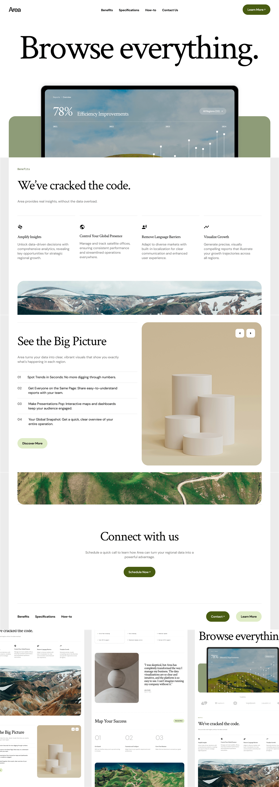
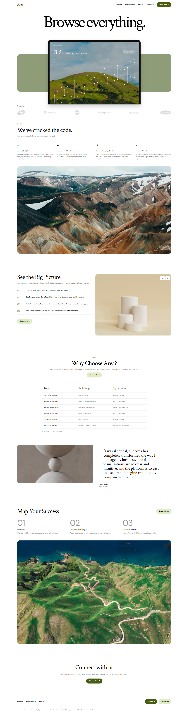

# Area — вёрстка лендинга по макету Figma

Ручная вёрстка лендинга по бесплатному макету **Modern Product Launch** из Figma Community.
Проект 2 портфолио: «макет → готовая страница».

- **Макет:** https://www.figma.com/community/file/1487309170684591074/modern-product-launch
- **Автор макета:** Figma Community
- **Лицензия:** бесплатный шаблон Figma Sites (лицензия Figma Community). Изображения использованы из этого шаблона, шрифты — Google Fonts (OFL).
- **Страница макета:** https://plugin-value-scrum.figma.site/

## Скриншоты

| Макет | Верстка |
|---|---|
|  |  |

Отдельные экраны макета: `screenshots/design-1.png` … `design-5.png`.

## Что сделано

- Чистые HTML + CSS + vanilla JS, без сборщиков и фреймворков.
- Дизайн-токены и типографика воспроизведены по макету (см. ниже).
- Адаптив: 1024 / 768 / 480 px, на 360 px горизонтальной прокрутки нет.
- JS только для интерактива: мобильное меню и переключатель картинок.
- SEO: title, description, один H1, `lang="en"`, alt у всех изображений.

## Дизайн-токены

| Токен | Значение |
|---|---|
| Фон / текст | `#ffffff` / `#000000` |
| Приглушённый текст | `#6f6f6f` |
| Оливковый (кнопки, акцент) | `#485c11` |
| Светло-зелёный (кнопки) | `#dfecc6` |
| Шалфей (панель в hero) | `#8e9c78` |
| Линии | `#e3e3e3` |
| Серые числа | `#929292` |
| Шрифт заголовков | Crimson Text, 160 px hero / 60 px секции / 18 px подзаголовки / 40 px цитата |
| Шрифт текста | DM Sans, 15 px, line-height 21 px |
| Шрифт меток и таблицы | Roboto Mono, 12 px |
| Контейнер | 1500 px, отступы 40 px |
| Секции | 80 px сверху, 120 px снизу |

## Запуск и тесты

Открой `index.html` в браузере. Тесты: `node --test tests/site.test.js`.

## Деплой

Отдельный репозиторий `landing_figma`, GitHub Pages из ветки `main`.
